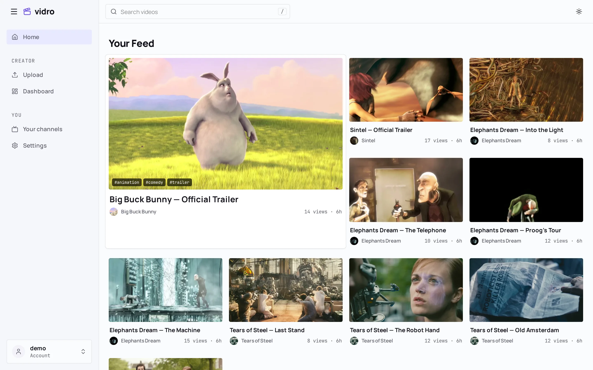
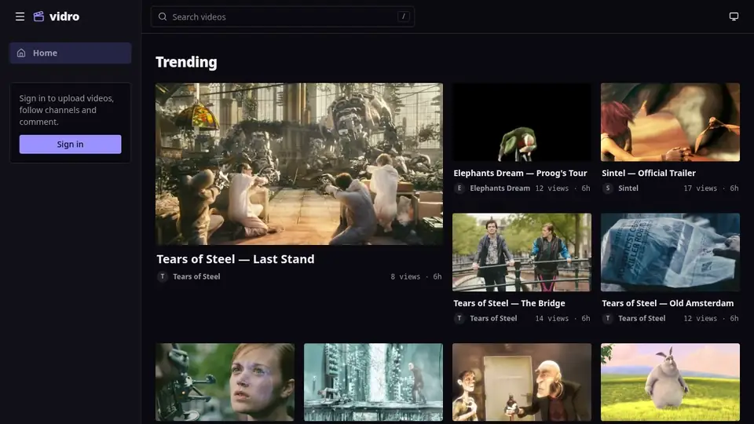
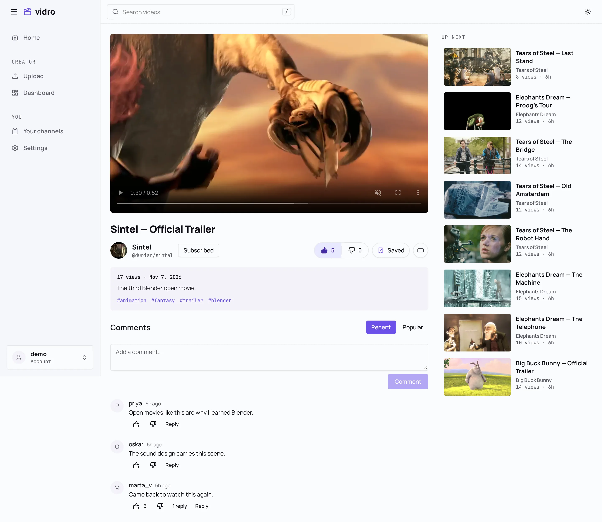
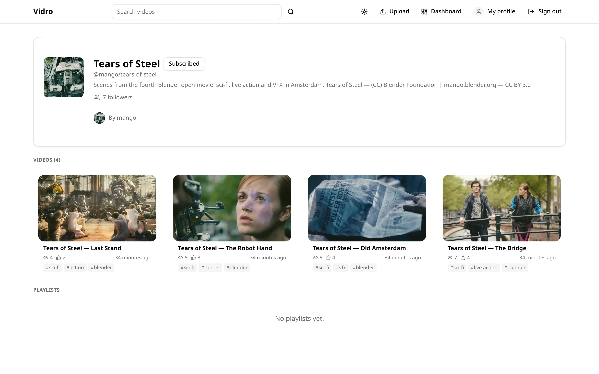
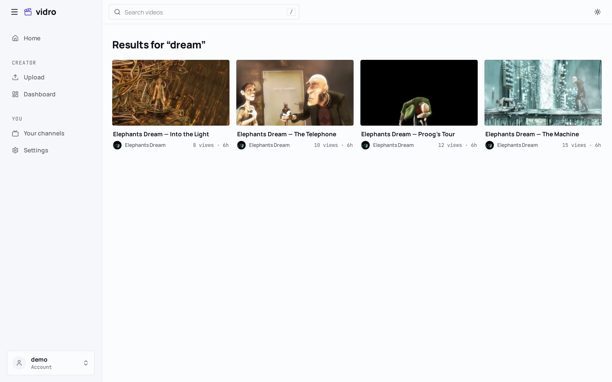
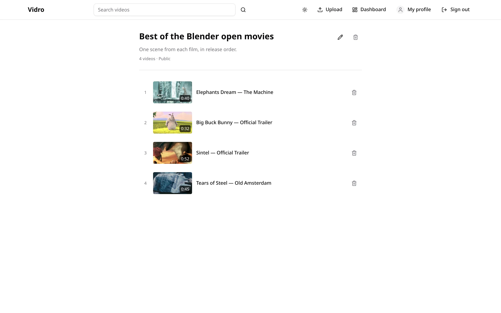
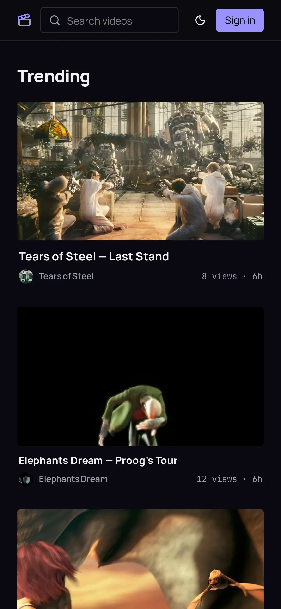
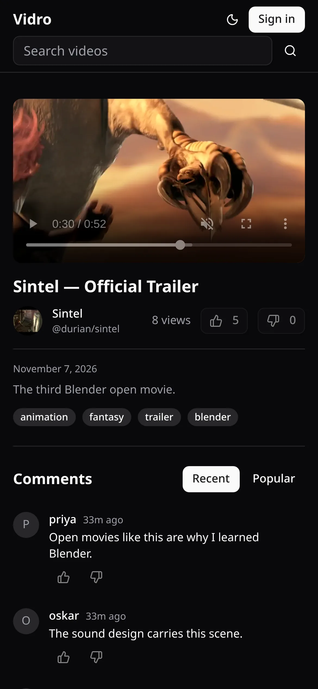
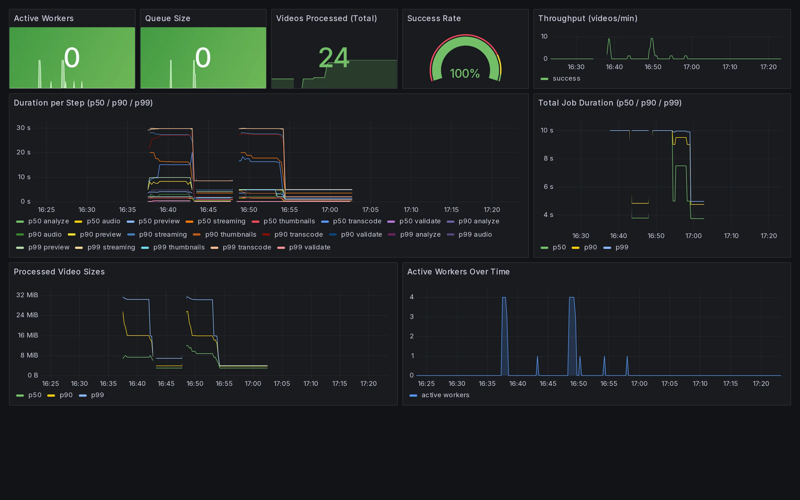

# Vidro

Video platform: upload, async transcode, playback. A **monorepo** of three services that run and version together.

Built to show a real pipeline — Redis job lease, a 7-step FFmpeg worker, HMAC webhooks, golden contract tests — not a tutorial CRUD.

<picture>
  <source media="(prefers-color-scheme: dark)" srcset="docs/media/home-dark.webp">
  
</picture>

The older split repos (`VidroApi`, `VidroFront`, `VidroProcessor`) are archived. This repo is the source of truth.

---

## Table of Contents

- [Screens](#screens)
- [Services](#services)
- [Run](#run)
- [The path across the three](#the-path-across-the-three)
- [Tests](#tests)
- [Docs](#docs)
- [Credits](#credits)
- [License](#license)

---

## Screens

Upload to playback through the real pipeline — presigned PUT, worker, webhook — in real time:



| | |
|---|---|
| <picture><source media="(prefers-color-scheme: dark)" srcset="docs/media/watch-dark.webp"></picture> | <picture><source media="(prefers-color-scheme: dark)" srcset="docs/media/channel-dark.webp"></picture> |
| **Watch** — processed MP4, reactions, threaded comments | **Channel** — avatar, followers, videos, playlists |
| <picture><source media="(prefers-color-scheme: dark)" srcset="docs/media/search-dark.webp"></picture> | <picture><source media="(prefers-color-scheme: dark)" srcset="docs/media/playlist-dark.webp"></picture> |
| **Search** — over titles and tags, public videos only | **Playlists** — per user or per channel, public or private |

<p>
  
  
</p>

The worker's Grafana dashboard — per-step FFmpeg durations, throughput, queue depth:



Every image here is generated: `make showcase` seeds the stack with Blender open movies and drives it
with Playwright ([`scripts/showcase/`](scripts/showcase/README.md)). Rerun it when the UI changes.

## Services

| Service | Role | Stack |
|---|---|---|
| [`VidroApi/`](VidroApi/) | REST API: auth, channels, videos, comments, playlists | .NET 10, Clean Architecture + Vertical Slice, Postgres, EF Core |
| [`VidroFront/`](VidroFront/) | Web UI, selective SSR | TanStack Start + React, shadcn/ui, Tailwind v4, bun |
| [`VidroProcessor/`](VidroProcessor/) | Transcode worker: Redis queue → 7-step FFmpeg pipeline → MinIO → webhook | Go |

Shared infra: **Postgres** (data), **Redis** (job queue), **MinIO** (objects), **Prometheus + Grafana + Loki** (observability).

## Run

```bash
make demo
```

Brings the stack up, generates a 10 s test video with the worker's FFmpeg, uploads it through the real path (presigned PUT → MinIO webhook → Redis → worker → HMAC webhook), waits for `PendingUpload → Processing → Ready` and prints the player URL. Needs docker, curl and jq; safe to rerun. If the stack fails to start because a host port is taken (5432, 5000, 3000…), free it and run `docker compose down` before rerunning — a failed start can leave containers without a network, and a plain rerun keeps them. Demo login: `demo@example.com` / `demo-password` (the video is public, so the player needs none). Source: [`scripts/demo.sh`](scripts/demo.sh).

Just the stack, no demo video:

```bash
docker compose up -d --build
```

| | URL | Credentials |
|---|---|---|
| Front | http://localhost:3000 | — |
| API | http://localhost:5000 (`/health`, `/openapi/v1.json`) | — |
| Grafana | http://localhost:3001 | `admin` / `admin` |
| MinIO console | http://localhost:9001 | `minioadmin` / `minioadmin` |
| Prometheus | http://localhost:9090 | — |

Dev credentials. The API applies EF migrations on startup, so Postgres can come up empty. For frontend work, prefer `bun run dev` on the host (HMR) against this stack.

To run one service against compose infra, see that service's README.

## The path across the three

```
browser ──1──▶ API ──2──▶ MinIO ──3──▶ API ──4──▶ Redis ──5──▶ Processor
                                                                   │
   player ◀──8── API ◀──7── webhook ◀────────── MinIO ◀──6─────────┘
```

1. Front asks for an upload URL; the API creates the video in `PendingUpload`.
2. Browser uploads straight to MinIO with a **presigned PUT** (`raw/<videoId>`).
3. MinIO notifies the API (`/webhooks/minio-upload-completed`).
4. The API publishes `videoId` on the Redis queue (`video_queue`) and marks `Processing`.
5. The processor consumes with `BRPOPLPUSH` (lease on `video_queue:processing`).
6. FFmpeg pipeline: validate → analyze → transcode → thumbnails → audio → preview → HLS. Artifacts go to MinIO.
7. The worker calls `/webhooks/video-processed` (HMAC-SHA256) with the generated paths.
8. The API marks `Ready`; the front plays the processed MP4.

Payloads, retries, and what happens when a hop fails: [`docs/end-to-end-flow.md`](docs/end-to-end-flow.md).
Stuck in `Processing`? [`docs/troubleshooting-stuck-video.md`](docs/troubleshooting-stuck-video.md).

## Tests

```bash
cd VidroApi       && dotnet test
cd VidroFront     && bun run test
cd VidroProcessor && go test ./...
```

CI: `.github/workflows/{api,front,processor}.yml` — one workflow per service, path-filtered, so a front change does not build .NET. There is no deploy pipeline; deploy is manual.

Load test (k6, API only): [`loadtest/README.md`](loadtest/README.md).

## Docs

| File | What it covers |
|---|---|
| [`docs/ARCHITECTURE.md`](docs/ARCHITECTURE.md) | Services, upload-to-`Ready` flow, lease/DLQ/reconciliation, contracts, limits |
| [`docs/end-to-end-flow.md`](docs/end-to-end-flow.md) | Each hop from upload to player: payloads, Redis keys, MinIO layout, retries, failures |
| [`docs/troubleshooting-stuck-video.md`](docs/troubleshooting-stuck-video.md) | Video stuck in `Processing` — API, Redis, worker, MinIO |
| [`docs/observability.md`](docs/observability.md) | Logs, metrics, and traces across the three services |
| [`docs/MONOREPO.md`](docs/MONOREPO.md) | Why it is a monorepo, what that cost |
| [`loadtest/README.md`](loadtest/README.md) | k6 API load test: how to run it, what each scenario measures |
| [`contracts/README.md`](contracts/README.md) | Golden files that lock the webhook payload, the job envelope and the enums the front mirrors |
| [`scripts/showcase/README.md`](scripts/showcase/README.md) | Regenerating the screenshots and the upload recording above |

Shared-contract changes (queue names, job envelope, MinIO paths, webhook shape) land on **both sides in the same commit** — that is the point of the monorepo.

## Credits

The footage in the screenshots and the recording is from the [Blender Foundation](https://www.blender.org/about/projects/)
open movies: *Elephants Dream* (CC BY 2.5), *Big Buck Bunny*, *Sintel* and *Tears of Steel* (CC BY 3.0).
© Blender Foundation | orange / peach / durian / mango.blender.org.

## License

[MIT](LICENSE)
