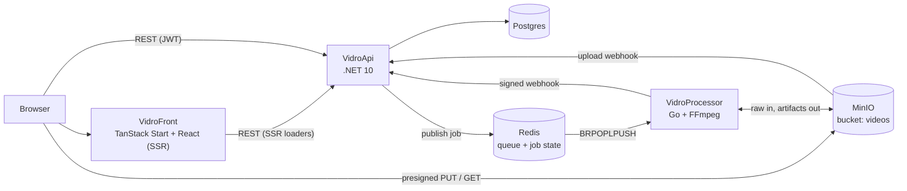
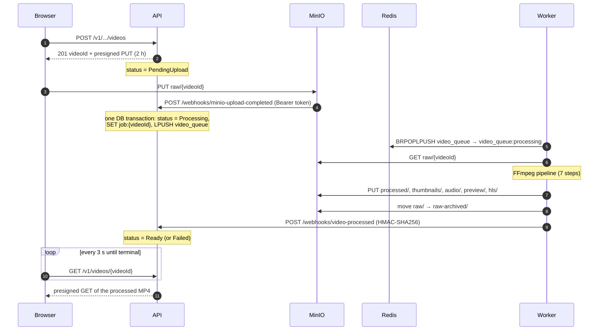
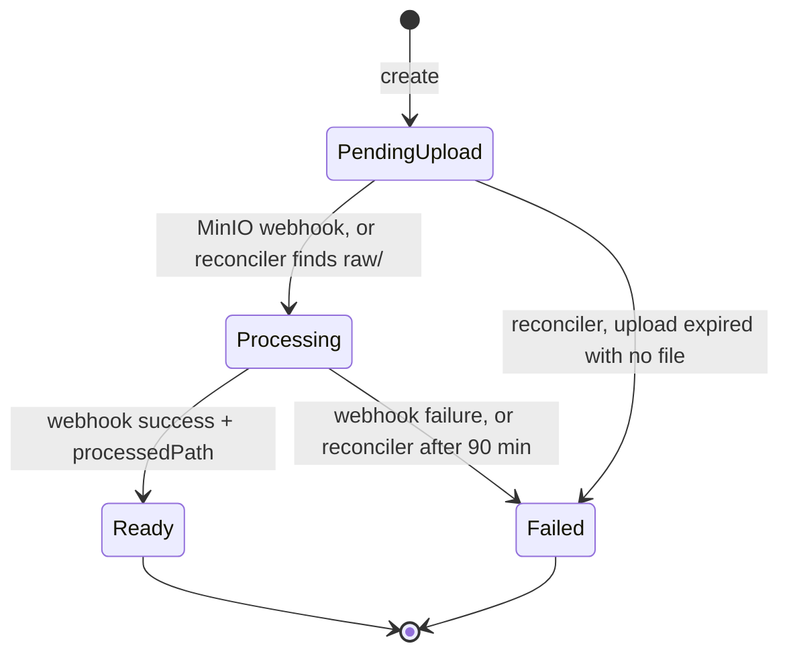

# Architecture

Vidro is a video platform: a user uploads a file, a worker transcodes it in the background, and
the browser plays the result. This document covers how the three services split that work, what
crosses each boundary, and why the asynchronous part looks the way it does.

It describes **decisions**, not operations. Payload fields, timeouts per hop and the failure mode of
each handoff are in [`end-to-end-flow.md`](end-to-end-flow.md); the stuck-video runbook is
[`troubleshooting-stuck-video.md`](troubleshooting-stuck-video.md).

---

## Components

| Component | Owns | Does not own |
|---|---|---|
| **VidroApi** | Users, channels, videos, comments, playlists (Postgres). The video's status. Signing MinIO URLs. Publishing jobs. | Video bytes — they never pass through it. |
| **VidroProcessor** | Running a job: download, FFmpeg pipeline, upload of artifacts, reporting back. Retries, lease recovery, dead-lettering. | Any domain state. It knows a `videoId` and a callback URL, nothing else. |
| **VidroFront** | UI, selective SSR, polling the video status. | Business rules; it renders what the API returns. |
| **Postgres** | Source of truth for the domain, including `VideoStatus`. | |
| **Redis** | The job queue and per-job state (`job:{videoId}`). Ephemeral by design: 24 h TTL. | Anything the API needs to answer a request. |
| **MinIO** | Every video byte: raw upload, processed MP4, thumbnails, audio, preview, HLS. | |
| **Prometheus / Grafana / Loki / Promtail** | Metrics from both backends, logs from every container. | |

API internals are Clean Architecture with vertical slices: one file per feature in
`VidroApi/src/VidroApi.Api/Features/`, `Domain ← Application ← Infrastructure ← Api`. Details in
[`VidroApi/docs/agents/architecture.md`](../VidroApi/docs/agents/architecture.md). The worker's
internals are in [`VidroProcessor/docs/agents/architecture.md`](../VidroProcessor/docs/agents/architecture.md).

### Two decisions that shape everything else

**Bytes bypass the API.** The browser uploads straight to MinIO with a presigned PUT and plays from
a presigned GET. The API only signs URLs. A multi-GB upload never holds an API thread, buffer or
request timeout, and the API scales with request count, not with video size.

**Processing is asynchronous and owned by a separate process.** Transcoding takes minutes and is
CPU/GPU bound. It runs in a Go worker fed by a Redis queue, so a slow or crashing FFmpeg cannot take
the API down, and workers scale independently (`WORKER_COUNT`, derived from CPU count by default).

---

## Upload to `Ready`

**The pipeline** (`processor.ProcessVideo`), in order:

| # | Step | Criticality | On failure |
|---|---|---|---|
| 1 | validate (ffprobe) | critical | job fails; an invalid file goes straight to the DLQ |
| 2 | analyze (duration, resolution, codecs…) | semi-critical | `Ready` without metadata |
| 3 | transcode → H.264 MP4, `+faststart` (libx264, or NVENC with CPU fallback) | critical | job fails |
| 4 | thumbnails (5) | non-critical | `Ready` without that artifact |
| 5 | audio (MP3) | non-critical | same |
| 6 | preview clip | non-critical | same |
| 7 | HLS | non-critical | same |

Steps 4–7 run in parallel by default. Splitting critical from non-critical is what keeps a broken
thumbnail from costing the user their video.

### Video status

The status lives only in Postgres. Redis has its own job status (`pending` / `processing` / `done` /
`failed`), but that belongs to the worker; the API never reads it back. The two meet only at the
webhook.

---

## Reliability: what can be lost, and what catches it

Every hop in the async path can fail independently: the browser drops mid-upload, MinIO's webhook
misses a down API, a worker is killed mid-transcode, the result webhook never arrives. The design
assumes each of these happens and gives every one a net. The full table is in
[`end-to-end-flow.md` → "Who fixes what"](end-to-end-flow.md#who-fixes-what); the mechanisms are
below.

### Lease: `BRPOPLPUSH` into `video_queue:processing`

A plain `BRPOP` deletes the job the moment a worker takes it. If that worker then dies, the job is
gone and the video sits in `Processing` forever. `BRPOPLPUSH` moves the id **atomically** into a
lease list instead, and the worker only removes it (`LREM`) after the outcome is recorded.

A recovery loop runs every minute and returns to `video_queue` any leased job whose `updated_at` is
older than the job budget + 1 minute, counting it as a failed attempt. The job budget is 18 min (13
of FFmpeg steps + 5 of transfer), and the job context enforces it by killing FFmpeg, so a live job
cannot look orphaned.

Cost: delivery is **at-least-once**. A job can run twice, so every write on both sides has to be
safe to repeat (see Idempotency below).

### Retries and the dead-letter queue: `video_queue:dead`

A failed critical step is retried: 4 attempts in total (`MaxJobRetries` = 3). Without a cap, a
poison file — corrupt, or one that crashes FFmpeg — would cycle forever and hold a worker slot each
time. After the last attempt the id goes to `video_queue:dead` and the worker sends a failure webhook,
so the user sees `Failed` instead of an endless spinner.

Two shortcuts skip the retries:

- **A permanent error.** ffprobe rejecting the file (`ErrInvalidVideo`) goes to the DLQ on the first
  attempt; retrying a corrupt file only burns worker time.
- **Missing job state.** If `job:{videoId}` expired or was deleted, the worker has no callback URL,
  so it dead-letters the id **without processing**. Processing it would archive the raw file without
  telling anyone. `raw/{videoId}` stays intact so the job can be requeued by hand.

The DLQ is a list on purpose: an operator can inspect it and requeue an id by hand, rewriting
`job:{videoId}` and pushing the id back ([runbook, step 7](troubleshooting-stuck-video.md#step-7--push-it-through-by-hand)).

### Reconciliation in the API

The API runs `VideoReconciliationService` every 15 min. It is the net for every hop the worker
cannot see:

- **Upload expired** (2 h): if `raw/{videoId}` exists, the MinIO webhook was lost, so the reconciler
  publishes the job itself. If nothing exists, the upload never happened, and the video becomes
  `Failed`.
- **`Processing` for more than 90 min:** the video becomes `Failed`. 90 is not arbitrary: it has to
  exceed the worker's worst case with every retry spent, which is 4 × (18 + 1 + 1) = 80 min. That
  sum is pinned in [`contracts/processing-timeout.json`](../contracts/processing-timeout.json) and
  tested from both sides, so changing the worker's retries or budget breaks a test if the API's
  timeout no longer covers it.

### Idempotency

Both webhook handlers act only on the status they expect (`PendingUpload` for the upload,
`Processing` for the result). A duplicate, a late arrival or an unknown id is answered **200**, so the sender does not retry something that can never succeed. One consequence is
deliberate: a video the reconciler already marked `Failed` does not go back to `Ready` if a late
success webhook shows up.

### Publishing inside the transaction

The upload handler does `status = Processing` → `SaveChanges` → publish to Redis → `Commit`. If the
save fails, no job exists. There is **no outbox**, so one gap remains: Redis accepts the job and
then the commit fails. The worker processes the video, the webhook is ignored (the video is not
`Processing`), and the reconciler eventually marks it `Failed`. The window is a failed commit right
after a successful Redis write, and it ends in a visible `Failed`, never in a silently wrong state.
An outbox table would close it at the cost of another background publisher.

### Webhook authentication

- **MinIO → API:** a static bearer token configured on the MinIO notification target.
- **Worker → API:** `X-Webhook-Signature: sha256=<hex>`, an HMAC-SHA256 of the raw body with a shared
  secret. The API verifies it in constant time. The worker refuses to start without the secret,
  because an empty secret used to mean every delivery got a 401. Delivery gets up to 3 attempts, retrying
  network errors, 5xx and 429 only.

### Correlation id

A queue has no headers, so a trace id dies at the queue boundary unless someone puts it in the
payload. The API generates an id for the MinIO webhook request (MinIO sends none), writes it into
the job envelope as `correlation_id`, and the worker stamps it on every log line for that job and
returns it in the result webhook's `X-Correlation-ID` header. One Loki query then shows API and
worker lines for the same upload.

What it does **not** do: it is not the id of the browser request that created the video. That
request has its own id (the front generates one per request and shows it on error screens). The two
are joined by `videoId`, which is the key that survives every retry, requeue and reconciliation.

---

## Contracts between services

API and worker are in different languages and share no types. The two most serious bugs found in
this repo were both the two sides disagreeing on the webhook's shape, so the boundaries are pinned by **golden
files** in [`contracts/`](../contracts/README.md). Both sides test against the same file, and every
CI workflow triggers on `contracts/**`, so renaming a field turns both builds red in the same run.

| Golden | Boundary |
|---|---|
| `job-state.json` | API → worker: queue name, `job:{videoId}` key, envelope fields (`callback_url`, `correlation_id`, `retry_count`, …) |
| `video-processed-*.json` (4 cases) | worker → API: result webhook, success with full, minimal and missing output, and failure |
| `processing-timeout.json` | worker's worst-case duration vs. the API's `Processing` timeout |
| `enums.json` | API → front: the six enums the front mirrors by hand as integers |

The API's URL surface is also versioned: [`VidroApi/openapi/v1.json`](../VidroApi/openapi/v1.json)
is generated, and CI fails if it changes without being committed.

**Not pinned:** the MinIO object layout. Output paths are safe, because the worker reports them in
the webhook and the API stores what it receives. The input key is the untested seam: `raw/{videoId}`
is agreed in four places that no test connects: the API signs it (`CreateVideo`) and parses it back
from the MinIO event, the reconciler checks it exists, the compose's notification filters on the
`raw/` prefix, and the worker downloads it.

The repo is a monorepo mainly so that a contract change lands on both sides in one commit
([`MONOREPO.md`](MONOREPO.md)).

---

## Playback

The player plays the **processed MP4** (`processed/{videoId}_processed`) through a presigned GET
valid for 4 h; thumbnails get 1 h URLs. The API returns these in `GET /v1/videos/{videoId}`. The bucket
has no public policy, so a private video's file is reachable only through a URL the API signs after
its visibility check.

The worker also generates an HLS ladder under `hls/{videoId}/` (`.m3u8` + `.ts`), the webhook
reports its path, and the API stores it, but does not return it to the player, which already plays
`.m3u8` through hls.js. Serving it takes more than adding a field: the playlist references segments
in a private bucket, so each segment needs its own signed URL or a proxy.

---

## Observability

| Signal | API | Worker |
|---|---|---|
| Logs | Serilog, `CorrelationId` on every line | zerolog JSON, `videoID` + `workerID` + `correlationID` |
| Metrics | native .NET meters (HTTP, Kestrel, rate limiting, Npgsql) on `/metrics` | processed count, duration, per-step duration, queue size, active workers |
| Traces | none | OpenTelemetry wired, no-op: there is no collector in the stack |

Promtail ships every container's stdout to Loki; Prometheus scrapes both backends; Grafana has a
provisioned worker dashboard. `videoId` is never a metric label (one series per video); it goes in
logs only. Details and open gaps: [`observability.md`](observability.md).

---

## Limits

The architecture is meant to be honest about where it stops.

- **Runs on one host.** The deployment unit is the root `docker-compose.yml`. There is no
  Kubernetes, no autoscaling and no multi-node setup; workers scale with `WORKER_COUNT` on one
  machine.
- **Deploy is manual.** CI builds and tests each service; nothing deploys.
- **MinIO stands in for S3.** The code talks the S3-compatible API, but the bucket and the upload notification are
  configured by the compose's `minio-init` container (the worker sets the 30-day `raw-archived/`
  lifecycle itself at startup). Outside the compose, nobody sets up the upload webhook.
- **Redis durability is the image default.** No AOF and no named volume: only periodic RDB
  snapshots on the image's anonymous `/data` volume. A crash loses writes since the last snapshot,
  and `docker compose down -v` wipes the queue and every `job:` key. The API's reconciler turns those
  videos into `Failed`; nothing replays them.
- **Single Redis, single Postgres, no replicas.** Fine for the scope, and the first thing to change
  for real traffic.
- **Uploads are one PUT.** No multipart and no resume; a dropped connection means starting over.
  The 5 GB size limit is enforced by the worker on download, not by the upload URL.
- **No distributed tracing.** The correlation id joins logs across services; there are no spans.
